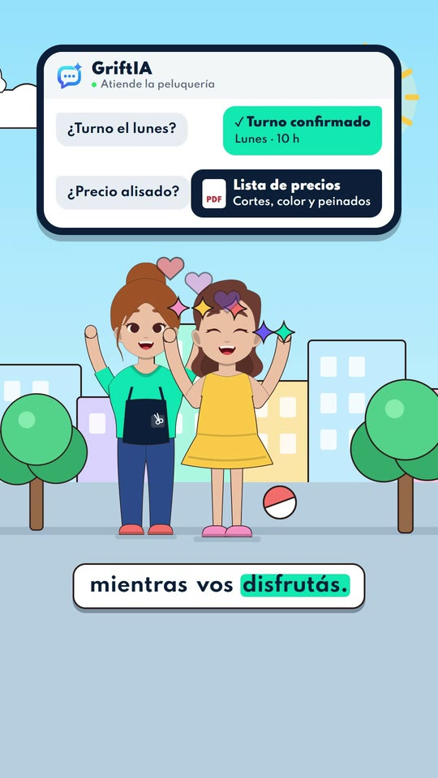
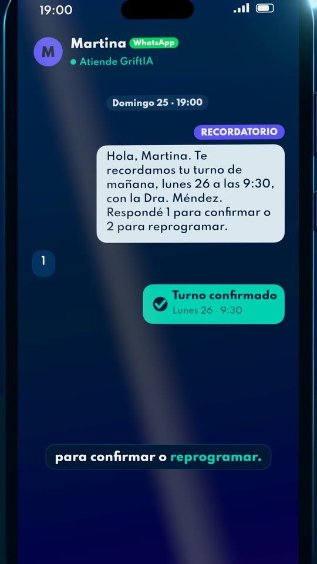
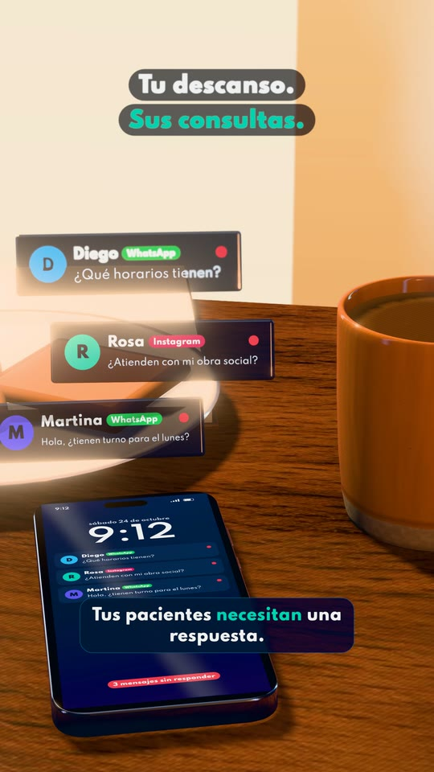

# Galería de videos

[GriftIA](https://griftia.com.ar) es un agente de IA de Griftin que responde las consultas de un negocio por WhatsApp e Instagram, agenda turnos e informa precios y horarios. Todos estos videos son publicidad de ese producto, hechos con las recetas de este sitio.

Están en el orden en que se hicieron, porque cada estilo salió de lo que no convenció del anterior. Las muestras están reducidas a 720 px para que el sitio cargue rápido.

## Animación

<figure markdown>
<video controls preload="none" poster="../media/cuadros/reel-anime.jpg" src="../media/video/reel-anime.mp4"></video>
<figcaption><strong>Reel estilo historieta</strong>30 s. Una peluquera tapada de mensajes a la noche. Nueve escenas, subtítulos de historieta, dos voces. Es de antes del manual de marca actual: todavía aparece la mascota robot.</figcaption>
</figure>

<figure markdown>
<video controls preload="none" poster="../media/cuadros/cartoon-estilo-b.jpg" src="../media/video/cartoon-estilo-b.mp4"></video>
<figcaption><strong>Caricatura de cuerpo completo</strong>La misma historia con personajes nuevos, elegidos entre seis bocetos. El producto ya no es un robot: es el símbolo del chat.</figcaption>
</figure>

<figure markdown>
<video controls preload="none" poster="../media/cuadros/halloween-peluqueria.jpg" src="../media/video/halloween-peluqueria.mp4"></video>
<figcaption><strong>Corto de Halloween</strong>21 s. Uno de tres cortos que comparten un módulo común; los disfraces son una capa sobre los mismos personajes.</figcaption>
</figure>

<figure markdown>

<figcaption><strong>Versión sin Halloween</strong>Los mismos tres cortos con cielo de día y otra música. Cambia la capa de decoración; la estructura es la misma.</figcaption>
</figure>

Recetas: [Animación 2D con HTML](../recetas/animacion-2d.md), [Voz en off gratis](../recetas/voz.md).

## 3D

<figure markdown>
<video controls preload="none" poster="../media/cuadros/comercial-3d.jpg" src="../media/video/comercial-3d.mp4"></video>
<figcaption><strong>Comercial 3D de estudio</strong>35 s. Estudio oscuro, celular, tarjetas que orbitan y el símbolo de la marca extruido. Sin cifras ni testimonios: solo lo que el producto hace.</figcaption>
</figure>

<figure markdown>

<figcaption><strong>La doctora</strong>41 s. Un consultorio cerrado el fin de semana: turnos para el lunes y recordatorio el domingo. Sin personaje; la historia la cuentan el cartel, el chat y la agenda.</figcaption>
</figure>

<figure markdown>

<figcaption><strong>Tu lunes empieza el sábado</strong>46 s. La misma idea con una mesa de desayuno en luz cálida y el celular apoyado sobre la mesa.</figcaption>
</figure>

Receta: [Comercial 3D](../recetas/tres-d.md).

## Producto real

<figure markdown>
<video controls preload="none" poster="../media/cuadros/producto-real-peluqueria.jpg" src="../media/video/producto-real-peluqueria.mp4"></video>
<figcaption><strong>Antes y después con pantallas reales</strong>30 s. Las pantallas son del panel real, con un negocio de demostración cargado para el video.</figcaption>
</figure>

<figure markdown>
<video controls preload="none" poster="../media/cuadros/dos-am.jpg" src="../media/video/dos-am.mp4"></video>
<figcaption><strong>2 a.m.</strong>30 s. Un dormitorio ilustrado, el reloj que corre de las 2 a las 8 y las consultas que se resuelven mientras tanto. Dos músicas: una para la noche y otra para el amanecer.</figcaption>
</figure>

Receta: [Producto en pantalla](../recetas/producto-en-pantalla.md).

## Filmación real

<figure markdown>

<figcaption><strong>Spot estilo cine</strong>48 s. Planos 4K con aspecto de película. La primera versión quedó oscura; esta es la segunda, con luz de día.</figcaption>
</figure>

<figure markdown>
<video controls preload="none" poster="../media/cuadros/spot-instagram.jpg" src="../media/video/spot-instagram.mp4"></video>
<figcaption><strong>Tu negocio responde siempre</strong>38 s. Dieciséis planos, uno por idea, con el chat del producto y pantallas del panel encima. Se entregó también como línea de tiempo editable.</figcaption>
</figure>

<figure markdown>
<video controls preload="none" poster="../media/cuadros/tenerife.jpg" src="../media/video/tenerife.mp4"></video>
<figcaption><strong>Tenerife, ya llegamos</strong>37 s. Filmación real de la isla en vertical. Acá apareció el problema de los clips en HDR.</figcaption>
</figure>

Recetas: [Filmación real de archivo](../recetas/filmacion-real.md), [Línea de tiempo para DaVinci](../recetas/davinci-otio.md).

## Tipografía y explicadores

<figure markdown>
<video controls preload="none" poster="../media/cuadros/tipografico.jpg" src="../media/video/tipografico.mp4"></video>
<figcaption><strong>Agentes de IA</strong>16,5 s, sin voz. Una palabra por golpe de la música a 123 pulsos por minuto.</figcaption>
</figure>

<figure markdown>
<video controls preload="none" poster="../media/cuadros/explicador.jpg" src="../media/video/explicador.mp4"></video>
<figcaption><strong>Es como contratar a alguien nuevo</strong>37 s. El agente dibujado como una credencial de empleado que se transforma de escena en escena.</figcaption>
</figure>

Recetas: [Spot tipográfico](../recetas/tipografico.md), [Explicadores](../recetas/explicadores.md).

## Qué enseñó cada etapa

| Etapa | Qué no convenció | Qué cambió |
| --- | --- | --- |
| Primera versión 3D | Baja calidad: 720p y valores por defecto | Maestro al doble, codificador en calidad alta, formato vertical |
| Personajes 3D | Se veían robóticos | Se pasó a caricatura 2D con expresiones |
| Mascota robot | El manual de marca pide no representar el producto como robot | El producto pasa a ser el símbolo del chat o la conversación misma |
| Personajes geométricos propios | No gustaron una vez animados | Bocetos de seis estilos antes de construir |
| Brazos por piezas | Se veían las uniones | Cada brazo, un solo trazo curvo |
| Cortos con música inaudible | La música quedaba muda bajo la voz | Ajuste suave bajo la voz y más volumen de base |
| Videos animados | Se pidió algo más profesional | Pantallas reales del producto |
| Spot de cine oscuro | No se veía bien | Luz de día, tabla de color al 40 %, viñeta mínima |
| Render grande sin aviso | Diez minutos perdidos si el diseño no gusta | Muestra corta antes del render |
