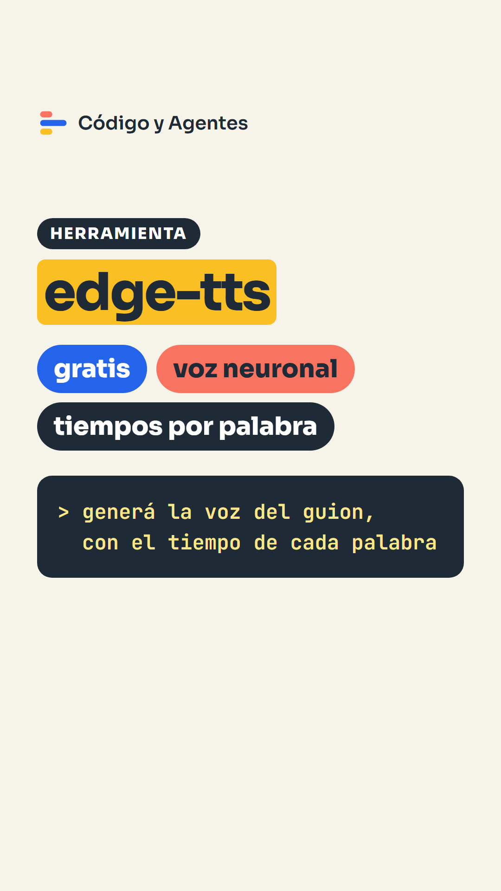
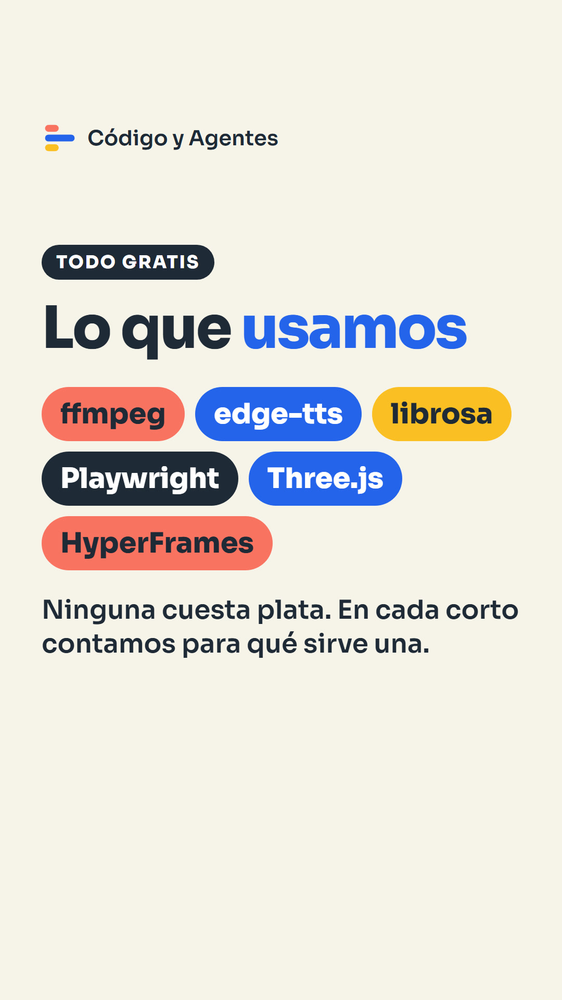

# Imágenes para historias

Cinco imágenes verticales (1080×1920) con la marca del canal. Mantené apretada cada una para guardarla en el teléfono.

## Historia 1

{ width="320" }

[Descargar](historia-1.jpg){ .md-button download="historia-1.jpg" }

## Historia 2

{ width="320" }

[Descargar](historia-2.jpg){ .md-button download="historia-2.jpg" }

## Historia 3

{ width="320" }

[Descargar](historia-3.jpg){ .md-button download="historia-3.jpg" }

## Historia 4

{ width="320" }

[Descargar](historia-4.jpg){ .md-button download="historia-4.jpg" }

## Historia 5

{ width="320" }

[Descargar](historia-5.jpg){ .md-button download="historia-5.jpg" }
