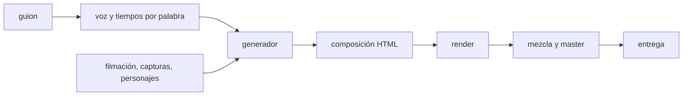

# Código y Agentes

Recetas para producir videos publicitarios desde una PC, con HTML, ffmpeg y herramientas gratuitas, sin cámara ni programa de edición.

Todo lo que está acá salió de hacer los videos de [GriftIA](https://griftia.com.ar), un agente de IA para negocios: caricaturas, comerciales 3D, spots con filmación real, demos del producto y explicadores. Cada receta cuenta qué se hizo, con qué comandos y qué salió mal en el camino.

<figure markdown>
<video controls preload="none" poster="media/cuadros/cartoon-estilo-b.jpg" src="media/video/cartoon-estilo-b.mp4"></video>
<figcaption><strong>Caricatura</strong>HTML, SVG y GSAP</figcaption>
</figure>

<figure markdown>
<video controls preload="none" poster="media/cuadros/comercial-3d.jpg" src="media/video/comercial-3d.mp4"></video>
<figcaption><strong>Comercial 3D</strong>Three.js sobre WebGPU</figcaption>
</figure>

<figure markdown>
<video controls preload="none" poster="media/cuadros/spot-instagram.jpg" src="media/video/spot-instagram.mp4"></video>
<figcaption><strong>Filmación real</strong>Clips de archivo y producto en pantalla</figcaption>
</figure>

<figure markdown>
<video controls preload="none" poster="media/cuadros/tipografico.jpg" src="media/video/tipografico.mp4"></video>
<figcaption><strong>Tipográfico</strong>Una palabra por golpe</figcaption>
</figure>

[Ver todos los videos](casos/index.md){ .md-button }

## La idea

Un video es un programa. El guion es un archivo de datos, la voz se genera a partir del guion, y un script escribe la imagen a partir de los tiempos de la voz. Cambiar una frase es cambiar una línea y volver a correr.

## Por dónde empezar

| Si querés… | Leé |
| --- | --- |
| Saber qué herramientas hacen falta | [Herramientas](herramientas.md) |
| Dejar todo andando en Windows | [Instalación en Windows](instalacion-windows.md) |
| Entender cómo se arma un video de punta a punta | [Flujo de trabajo](flujo.md) |
| Locución gratis con subtítulos sincronizados | [Voz en off gratis](recetas/voz.md) y [Subtítulos](recetas/subtitulos.md) |
| Un spot con imagen real | [Filmación real de archivo](recetas/filmacion-real.md) |
| Mostrar tu aplicación en un comercial | [Producto en pantalla](recetas/producto-en-pantalla.md) |
| Que suene bien en redes | [Música, efectos y mezcla](recetas/audio.md) |
| Resolver un error puntual | [Problemas conocidos](problemas.md) |

## Qué hay en el repositorio

- **Esta documentación**, en [`docs/`](https://github.com/gastongv/codigo-y-agentes/tree/main/docs).
- **Scripts de ejemplo**, en [`scripts/`](https://github.com/gastongv/codigo-y-agentes/tree/main/scripts): los que se usaron en los videos, para copiar y adaptar.
- **Muestras de los videos**, reducidas a 720 px.

## Con qué se hizo

[HyperFrames](https://github.com/heygen-com/hyperframes) para componer y renderizar, [Eidoverse](https://github.com/SkyeShark/eidoverse-video) para el 3D, [FFmpeg](https://ffmpeg.org/) para casi todo lo demás, [edge-tts](https://github.com/rany2/edge-tts) para la voz y [Claude Code](https://claude.com/claude-code) como agente que escribe los generadores y corre los comandos. El detalle está en [Herramientas](herramientas.md).
