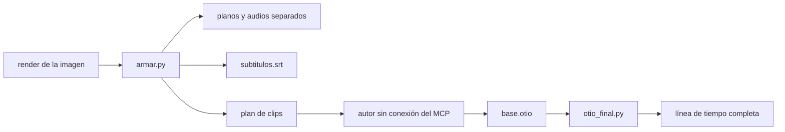

# Línea de tiempo para DaVinci

A veces el video tiene que quedar **editable**: alguien quiere mover un plano, cambiar la música o retocar un corte en DaVinci Resolve. En lugar de entregar solo el MP4, se entrega además una línea de tiempo con cada plano y cada audio por separado.

## El límite de la edición gratuita

DaVinci Resolve gratuito (probado con la versión 21.2) no acepta control desde afuera:

- El acceso por scripts externos está reservado a la edición Studio: las llamadas devuelven vacío.
- Desde la versión 21.1, el menú de scripts de la edición gratuita ya no lista scripts de Python.
- Los scripts Lua del menú sí corren, pero muy limitados: no pueden leer ni escribir archivos.

Por eso el servidor MCP de DaVinci Resolve no puede manejar el programa en vivo con la edición gratuita.

## El camino que sirve: un archivo `.otio`

[OpenTimelineIO](https://opentimelineio.readthedocs.io/) es un formato abierto de líneas de tiempo que Resolve importa con **File > Import > Timeline**. El archivo se escribe sin tener Resolve abierto.

### 1. Separar el material

[`scripts/davinci/armar.py`](https://github.com/gastongv/video-con-codigo/blob/main/scripts/davinci/armar.py) parte del render de la imagen y de un `montaje.json` con los tiempos, y deja:

- Un archivo de video por plano, cortado exacto al cuadro, con los textos y el producto ya compuestos.
- Un WAV por frase de voz, la música con su volumen y sus fundidos, y un WAV por efecto con el volumen de la mezcla aplicado.
- `subtitulos.srt`.
- El MP4 terminado, con la misma mezcla.
- El plan de clips para el paso siguiente.

### 2. Escribir la línea de tiempo base

El MCP de DaVinci Resolve tiene un modo sin conexión que escribe un `.otio` a partir de una lista de clips: `timeline(action='author_offline', target='otio')`. Cada clip lleva su ruta, el cuadro donde va en la línea de tiempo y su duración.

Dos detalles: pasar `media_start_tc_frame: 0` y los cuadros por segundo en cada clip.

Este modo escribe **una pista de video y una de audio**.

### 3. Agregar las pistas que faltan

[`scripts/davinci/otio_final.py`](https://github.com/gastongv/video-con-codigo/blob/main/scripts/davinci/otio_final.py) abre ese archivo (es JSON), toma un clip y un hueco de la pista de audio como moldes y arma con la misma estructura exacta:

- Una pista para la música.
- Las pistas de efectos que hagan falta: cada efecto va a la primera pista donde no se pisa con el anterior.

Clonar la estructura que ya escribió la herramienta es más seguro que armar los objetos desde cero: Resolve es estricto con el formato.

## Qué no se puede

| Intento | Resultado |
| --- | --- |
| Archivo nativo `.drt` con varios clips | Necesita Resolve conectado para tomar una plantilla de medios |
| Títulos de texto escritos por la herramienta | Importan vacíos. El texto va como subtítulos `.srt` o ya compuesto en la imagen |
| Guiar a la persona para que corra scripts y pegue la consola | Funciona, pero cansa enseguida. Mejor el archivo importable |

## Para ver Resolve sin tocar el mouse

En Windows, `PrintWindow` captura la ventana de Resolve aunque esté tapada por otra. Abrir Resolve usa la placa de video: tenerlo en cuenta si la PC está ocupada.

!!! warning "Sin verificar"
    Los archivos `.otio` generados pasan la validación de la herramienta, pero al momento de escribir esto su importación en Resolve no estaba confirmada en la práctica. Probarlo con un proyecto chico antes de depender de este camino.
